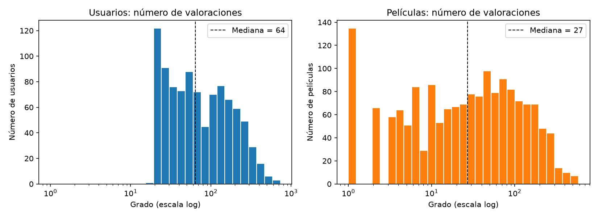
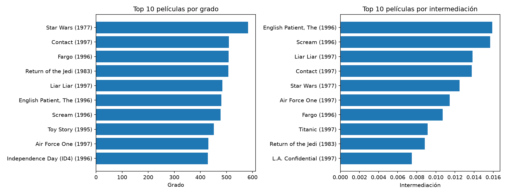
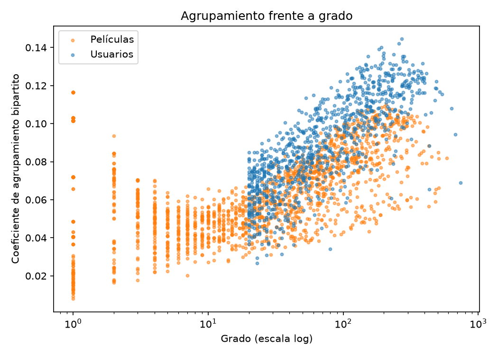
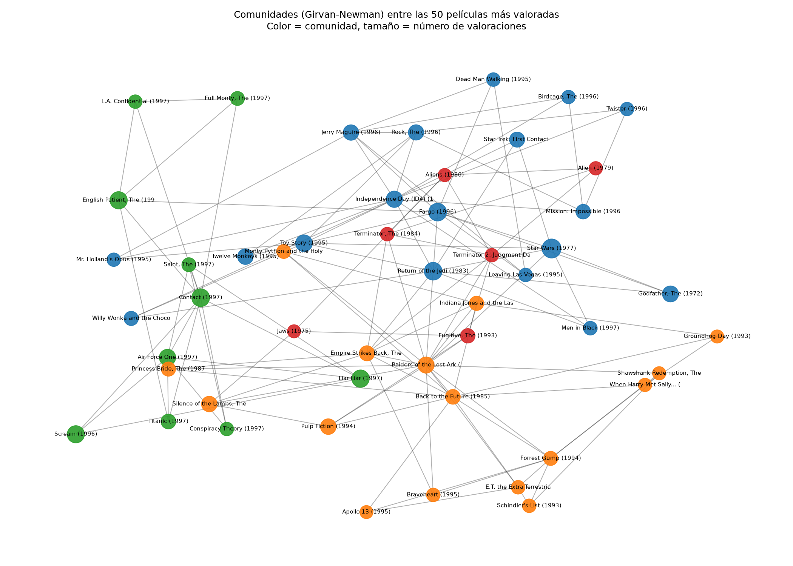
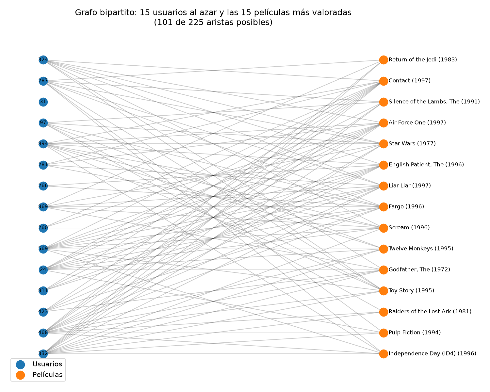
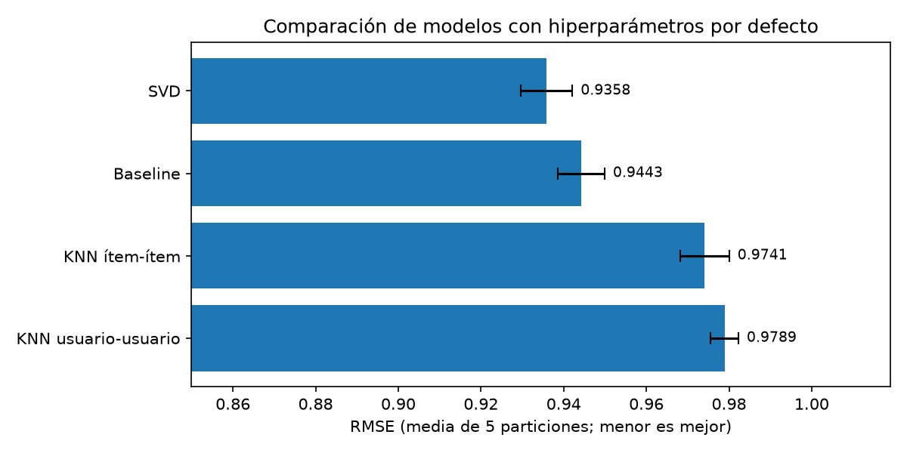
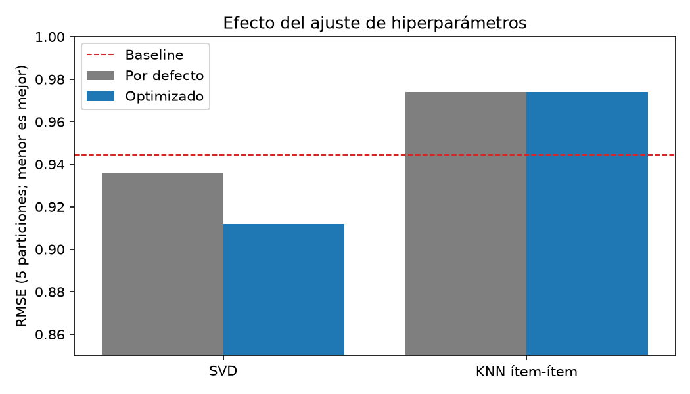

# Taller 03: Análisis de Redes y Sistemas de Recomendación con MovieLens 100K

## Objetivo

1. **Análisis de redes:** representar las valoraciones de MovieLens como un grafo usuario–película y, con `networkx`, identificar los nodos más centrales, medir el agrupamiento y detectar comunidades.
2. **Sistemas de recomendación:** entrenar modelos de filtrado colaborativo (SVD y KNN) con `surprise`, compararlos por RMSE, ajustar sus hiperparámetros y generar recomendaciones para un usuario.

## Datos

[MovieLens 100K](https://grouplens.org/datasets/movielens/100k/) (GroupLens Research): 100,000 valoraciones de 1 a 5 estrellas, de 943 usuarios sobre 1,682 películas, recogidas entre septiembre de 1997 y abril de 1998. Cada usuario valoró al menos 20 películas.

Los datos **no se incluyen en el repositorio**, porque la licencia de GroupLens no permite redistribuirlos. El script `00_descarga_datos.py` los descarga desde la fuente oficial.

## Estructura del repositorio

```
mcd_movielens/
├── data/                  # no se sube a GitHub (se genera con los scripts)
│   ├── raw/               # ml-100k original
│   └── processed/         # valoraciones.csv, peliculas.csv
├── scripts/
│   ├── 00_descarga_datos.py     # descarga y extracción
│   ├── 01_preparacion.py        # revisión y limpieza
│   ├── 02_grafo.py              # grafo bipartito, centralidad, agrupamiento
│   ├── 03_comunidades.py        # Girvan-Newman y visualización
│   ├── 04_recomendacion.py      # comparación de modelos
│   └── 05_optimizacion.py       # ajuste de hiperparámetros y top-5
├── reports/
│   ├── 0X_registro_*.txt        # salida de cada script
│   ├── 04_resultados_modelos.csv
│   └── figures/
├── requirements.txt
└── README.md
```

## Cómo reproducir el análisis

Requiere el entorno conda `mcd` (Python 3.11). Se recomienda instalar `scikit-surprise` desde conda-forge, porque con `pip` en Windows necesita un compilador de C.

```bash
conda activate mcd
conda install -c conda-forge scikit-surprise
pip install -r requirements.txt

python scripts/00_descarga_datos.py
python scripts/01_preparacion.py
python scripts/02_grafo.py           # ~1 min
python scripts/03_comunidades.py
python scripts/04_recomendacion.py   # ~1 min
python scripts/05_optimizacion.py    # ~5-8 min
```

Los scripts deben ejecutarse en orden, porque cada uno usa los archivos que genera el anterior.

---

## 1. Preparación de los datos

**Calidad de los datos.**

- No hay valores nulos en las valoraciones.
- No hay valoraciones repetidas de un mismo usuario a una misma película.
- No hay valoraciones de películas inexistentes.

**Títulos repetidos.** Se encontraron **18 películas registradas dos veces** con códigos distintos (por ejemplo, *Chasing Amy (1997)*: códigos 246 y 268).

- Se unificaron en un solo código. Si no, una misma película sería dos nodos en el grafo, y podría recomendarse una película que el usuario ya vio bajo el otro código.
- Cuando un usuario había valorado las dos versiones, se conservó su valoración más reciente.

| | Original | Después de unificar |
|---|---|---|
| Películas | 1,682 | 1,664 |
| Valoraciones | 100,000 | 99,693 |

**Características generales.**

- **Matriz muy dispersa.** Cada usuario ha visto, en promedio, solo el 6.35 % de las películas; el 93.65 % de la matriz usuario–película está vacía. Esta es la situación típica de un sistema de recomendación.
- **Distribución de los ratings.** El rating medio es **3.53** y los más frecuentes son 4 (34 %) y 3 (27 %). Los usuarios tienden a valorar más las películas que les gustan.
- **Actividad de los usuarios.**
  - La mediana es de 64 valoraciones por usuario.
  - El más activo tiene 736.
- **Valoraciones por película.**
  - La mediana es de 27 valoraciones por película.
  - *Star Wars* tiene 583.
  - 135 películas tienen una sola valoración.

---

## 2. Análisis de redes

### 2.1 El grafo bipartito

Las valoraciones se representan como un **grafo bipartito**: hay dos tipos de nodos (usuarios y películas), y una arista une a un usuario con cada película que valoró. No hay aristas entre dos usuarios ni entre dos películas.

| Nodos | Aristas | Componentes conexas |
|---|---|---|
| 2,607 (943 usuarios + 1,664 películas) | 99,693 | 1 |

Que haya una sola componente significa que desde cualquier usuario se puede llegar a cualquier otro a través de películas en común.



El **grado** de un nodo es su número de conexiones. Ambas distribuciones son asimétricas: la mayoría de usuarios y películas tienen pocas valoraciones, y unos pocos tienen muchas. La barra de la izquierda en las películas son las 135 que tienen una sola valoración.

### 2.2 Centralidad de grado: usuarios más activos y películas más populares

**Tarea de desafío: los 5 usuarios que califican más películas.**

| Usuario | Películas valoradas | Centralidad de grado | Rating medio |
|---|---|---|---|
| 405 | 736 | 0.442 | 1.84 |
| 655 | 678 | 0.407 | 2.90 |
| 13 | 632 | 0.380 | 3.10 |
| 450 | 538 | 0.323 | 3.86 |
| 276 | 516 | 0.310 | 3.47 |

La centralidad de grado es la proporción de películas que valoró cada usuario: el usuario 405 valoró el 44 % de todo el catálogo.

**Usuario 405: un caso atípico.** Es el más activo, pero puntúa muy bajo (media 1.84 frente a 3.53 general). Este tipo de usuario es importante en la Parte 2: los modelos que no corrigen este "sesgo" del usuario predicen peor.

**Películas más valoradas:** *Star Wars* (583), *Contact* (509), *Fargo* (508), *Return of the Jedi* (507), *Liar Liar* (485).

### 2.3 Películas más centrales

**Tarea de desafío.** Se usaron dos medidas de centralidad:

- **Grado:** cuántos usuarios valoraron la película (popularidad).
- **Intermediación:** con qué frecuencia la película está en el camino más corto entre otros nodos. Una película con alta intermediación actúa como "puente" entre grupos de usuarios distintos.



Las dos medidas coinciden en 8 de las 10 películas: en general, las más populares también son los principales puentes. Las diferencias son las siguientes:

- **El orden cambia:** *The English Patient* y *Scream* son los mayores puentes, aunque *Star Wars* es la más valorada.
- ***Titanic* y *L.A. Confidential*** entran al top 10 por intermediación sin estar en el top 10 por grado. Ambas se estrenaron a finales de 1997, al final del periodo de los datos: las valoraron menos usuarios, pero de perfiles muy variados.

### 2.4 Coeficiente de agrupamiento

El coeficiente de agrupamiento clásico mide cuántos **triángulos** forma un nodo con sus vecinos. En un grafo bipartito no puede haber triángulos (dos usuarios nunca están conectados directamente), así que ese coeficiente vale 0. El script lo verifica: el grafo tiene 0 triángulos.

Por eso se usó el **coeficiente de agrupamiento bipartito**. Mide cuánto se parecen los vecinos de un nodo a los de otros nodos de su mismo tipo: por ejemplo, cuántas películas en común tiene un usuario con otros usuarios.

| | Agrupamiento medio |
|---|---|
| Usuarios | 0.089 |
| Películas | 0.062 |



- **Relación con el grado.** El agrupamiento aumenta con el grado: los usuarios y películas con más valoraciones comparten más vecinos con otros.
- **Excepción.** Las películas con una sola valoración (columna de la izquierda) tienen valores dispersos que dependen solo de ese único usuario, así que no deben interpretarse.

### 2.5 Detección de comunidades (Girvan-Newman)

**Método.** El algoritmo de Girvan-Newman elimina, una a una, las aristas que más funcionan como "puente", hasta que el grafo se divide en grupos. Como recalcula todo el grafo después de cada eliminación, es muy lento en grafos grandes, y no se puede aplicar a las ~100,000 aristas del grafo completo. Por eso se trabajó con un subgrafo:

1. **Selección.** Se tomaron las **50 películas más valoradas** (todas con al menos 276 valoraciones).
2. **Proyección.** Dos películas se conectan según la **proporción de usuarios que comparten**: el índice de Jaccard, igual a usuarios en común dividido entre usuarios totales de ambas.
3. **Simplificación.** Cada película se conectó solo con sus **3 películas más similares**. Si no, todas quedarían conectadas con todas.
4. **Girvan-Newman.** Se aplicó al subgrafo resultante y se eligió el número de comunidades con mayor **modularidad**, una medida de qué tan separados están los grupos.

**Resultado:** 4 comunidades, con modularidad **0.589**. Valores por encima de ~0.3 se consideran una estructura de comunidades clara.

**Tarea de desafío: visualizar la red con enfoque en las comunidades.**



| Comunidad | Películas | Ejemplos | ¿Qué las une? |
|---|---|---|---|
| 1 | 18 | *Star Wars*, *Toy Story*, *Independence Day*, *Twister* | Éxitos comerciales de 1995–1996 y algunos clásicos muy populares |
| 2 | 16 | *Raiders of the Lost Ark*, *Back to the Future*, *E.T.*, *Shawshank Redemption* | Clásicos de 1974–1995 |
| 3 | 10 | *Contact*, *Titanic*, *Scream*, *L.A. Confidential* | Todas son estrenos de 1996–1997 |
| 4 | 6 | *Terminator* 1 y 2, *Alien*, *Aliens*, *Jaws* | Acción y ciencia ficción (100 % acción) |

**Interpretación.**

- Solo la comunidad 4 está definida por el **género**. Las otras tres agrupan películas por **época**, es decir, por cuándo las vio el público.
- La comunidad 3, por ejemplo, reúne los estrenos que los usuarios veían en el cine mientras se recogían los datos.

**Ejemplo ilustrativo: la trilogía de *Star Wars*.** *Star Wars* y *Return of the Jedi* quedan en la comunidad 1, pero *The Empire Strikes Back* queda en la comunidad 2, junto a *Raiders* e *Indiana Jones*. Las comunidades no reflejan de qué trata la película, sino **quiénes la vieron**: la audiencia de *Empire* se parece más a la de las películas de aventura clásicas.

### 2.6 Visualización de una parte del grafo bipartito



La figura muestra 15 usuarios elegidos al azar y las 15 películas más valoradas.

- Entre ellos existen 101 de 225 conexiones posibles (45 %), mucho más que el 6.35 % del grafo completo: las películas populares concentran las valoraciones.
- Aun así, el usuario 31 no valoró ninguna de estas 15 películas, lo que refleja la diversidad de gustos.

---

## 3. Sistemas de recomendación

### 3.1 Modelos

| Modelo | Idea |
|---|---|
| **Baseline** | Referencia: rating medio general, ajustado por si el usuario puntúa alto o bajo y por si la película suele gustar o no |
| **KNN usuario-usuario** | Predice el rating promediando los de los usuarios más parecidos |
| **KNN ítem-ítem** | Predice el rating promediando los que el usuario dio a las películas más parecidas |
| **SVD** | Factorización de matrices: resume a cada usuario y cada película en un conjunto de "factores ocultos" (por ejemplo, gusto por la acción) y predice el rating combinándolos |

Todos se evaluaron con **validación cruzada de 5 particiones**: los datos se dividen en 5 partes, se entrena con 4 y se evalúa con la quinta, y así 5 veces. Se usó la métrica **RMSE**, que mide el error medio en estrellas: cuanto menor, mejor.

### 3.2 Comparación con los parámetros por defecto

**Tarea de desafío: comparar SVD y KNN en RMSE.**

| Modelo | RMSE | MAE |
|---|---|---|
| **SVD** | **0.9358** | 0.7370 |
| Baseline | 0.9443 | 0.7486 |
| KNN ítem-ítem | 0.9741 | 0.7693 |
| KNN usuario-usuario | 0.9789 | 0.7732 |



- **SVD** es el mejor modelo, aunque supera por poco al Baseline.
- **Los dos KNN son peores que el Baseline.** El KNN básico promedia los ratings de los vecinos sin corregir que algunos usuarios puntúan siempre más alto o más bajo, como el usuario 405. El Baseline sí corrige ese efecto.
- **KNN ítem-ítem** es algo mejor que usuario-usuario, por lo que fue la variante elegida para el ajuste.

### 3.3 Ajuste de hiperparámetros (Grid Search)

**Tarea de desafío: optimizar los hiperparámetros para obtener el RMSE más bajo.** Se probaron todas las combinaciones de una grilla de valores, con las mismas 5 particiones.

**SVD (24 combinaciones).** Mejores resultados:

| `n_factors` | `n_epochs` | `lr_all` | `reg_all` | RMSE |
|---|---|---|---|---|
| 100 | 30 | 0.01 | 0.1 | **0.9119** |
| 150 | 30 | 0.01 | 0.1 | 0.9124 |
| 50 | 30 | 0.01 | 0.1 | 0.9137 |

- **`reg_all` (regularización).** Es el parámetro más importante: un valor más alto evita que el modelo se ajuste demasiado a usuarios y películas con pocas valoraciones.
- **`n_epochs` y `lr_all`.** Más épocas y una tasa de aprendizaje mayor permiten que el modelo termine de aprender.
- **`n_factors`.** Casi no influye: con 50, 100 o 150 factores el RMSE es prácticamente el mismo.

**KNN ítem-ítem (12 combinaciones).** RMSE según el número de vecinos `k` y la medida de similitud:

| `k` | cosine | msd | pearson_baseline |
|---|---|---|---|
| 20 | 1.0477 | 0.9825 | 0.9949 |
| 40 | 1.0264 | **0.9741** | 0.9921 |
| 60 | 1.0231 | 0.9767 | 0.9925 |
| 80 | 1.0242 | 0.9815 | 0.9932 |

- **La mejor combinación es la de los valores por defecto** (`k` = 40, `msd`), así que el ajuste no mejoró el modelo.
- **`k`.** Con pocos vecinos la predicción es inestable; con demasiados se incluyen películas poco parecidas.
- **`cosine`.** Es la peor similitud, porque con ratings siempre positivos casi todas las películas parecen similares.

**Resultado final:**

| Modelo | RMSE por defecto | RMSE optimizado | Mejora |
|---|---|---|---|
| **SVD** | 0.9358 | **0.9119** | 2.56 % |
| KNN ítem-ítem | 0.9741 | 0.9741 | 0.00 % |
| Baseline | 0.9443 | — | — |



SVD optimizado es el mejor modelo y supera claramente al Baseline. KNN sigue por debajo del Baseline: su problema no se resuelve con hiperparámetros, sino con una variante del algoritmo que corrija los sesgos de usuario.

### 3.4 Recomendaciones para un usuario

**Tarea de desafío: top-5 de películas para un usuario específico.**

**Procedimiento.**

1. Se reentrenó el SVD optimizado con todos los datos.
2. Se predijo el rating del **usuario 1** para todas las películas que no ha visto y que tienen al menos 20 valoraciones, para no recomendar películas que casi nadie conoce.
3. Se eligieron las 5 con mayor rating predicho.

**Perfil del usuario 1.**

- Valoró 271 películas, 80 de ellas con 5 estrellas.
- Entre sus favoritas: *Star Wars*, *Fargo*, *Raiders of the Lost Ark*, *The Godfather*, *Empire Strikes Back*.

| Rating predicho | Película | Géneros | Rating medio general |
|---|---|---|---|
| 4.80 | *A Close Shave* (1995) | Animación, Comedia | 4.49 |
| 4.59 | *Casablanca* (1942) | Drama, Romance, Guerra | 4.46 |
| 4.59 | *Lawrence of Arabia* (1962) | Aventura, Guerra | 4.23 |
| 4.56 | *The Third Man* (1949) | Misterio, Thriller | 4.33 |
| 4.54 | *Secrets & Lies* (1996) | Drama | 4.26 |

Las recomendaciones son coherentes con el perfil del usuario, que valora bien el cine clásico y aclamado. Al mismo tiempo, todas son películas con ratings medios muy altos: el modelo tiende a recomendar películas que gustan a casi todos.

---

## 4. Conclusiones

1. **Popularidad.** La red usuario–película es muy dispersa y desigual: pocas películas concentran gran parte de las valoraciones, y las más populares son también las más centrales.
2. **Comunidades.** Agrupan las películas más por **época de consumo** que por género. Los usuarios que coinciden en el tiempo ven películas parecidas.
3. **Modelos.** SVD optimizado logró el menor error (**RMSE = 0.9119**). Entre todos los hiperparámetros, la regularización fue el que más influyó.
4. **El Baseline como referencia.** Un modelo simple que solo corrige los sesgos de usuarios y películas supera al KNN básico. Siempre conviene comparar contra una referencia simple antes de concluir que un modelo funciona bien.

## 5. Limitaciones

- **Subgrafo de comunidades.** Girvan-Newman se aplicó solo a las 50 películas más valoradas; las comunidades del catálogo completo podrían ser distintas.
- **Intermediación aproximada.** Se calculó con una muestra de 500 nodos, para reducir el tiempo de cálculo.
- **Grilla de SVD.** Los mejores valores quedaron en el límite de la grilla (`n_epochs` = 30, `lr_all` = 0.01, `reg_all` = 0.1); ampliarla podría reducir algo más el RMSE.
- **Sesgo hacia películas aclamadas.** Las recomendaciones se basan solo en ratings, no en el contenido de las películas, y favorecen películas con ratings medios altos.
- **Antigüedad de los datos.** Son de 1997–1998 y no necesariamente representan hábitos actuales.

